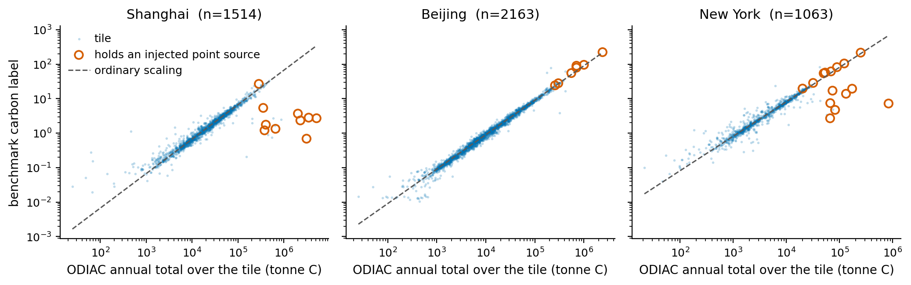

# What Does a Carbon Score Measure?

Code for *What Does a Carbon Score Measure? A Case Study of Three Cities in an Urban Emissions
Benchmark*, Tackling Climate Change with Machine Learning workshop at NeurIPS 2026.

Several urban prediction models train on ODIAC carbon as a target. ODIAC builds its urban spatial
pattern from two components: nighttime lights, which these benchmarks also use as a target, and a
power-plant database with a 2007 base year. On the three-city benchmark released with UrbanMoE
(Liu et al., WWW 2026), this code measures how much of the carbon score each component explains,
and flags the tiles that hold injected plant values from the ODIAC raster alone, before any model
is trained.



## Setup

Python 3.11.

```
pip install -r requirements.txt
```

Only `embed_images.py` benefits from a GPU (it takes about 30 minutes on a CPU). Once their
inputs are in place, the analysis steps each run on a CPU in under a minute. The first run of
`odiac.py` spends about 20 minutes downloading, and `count_pois.py` spends most of its time
parsing the OSM extracts.

## Data

No third-party data is redistributed. Each source is public:

- **Benchmark release**: 4,959 tiles over Shanghai, Beijing and New York with `c_value`,
  `pop_value` and `light_value`. Extract it into `data/raw/urbanmoe/` so that it contains
  `shanghai/`, `beijing/` and `NewWork/` (the release's own spelling).
- **OpenStreetMap**: `china-latest.osm.pbf` and `us-northeast-latest.osm.pbf` from
  [Geofabrik](https://download.geofabrik.de/) (about 1.5 GB and 1.7 GB, ODbL), in
  `data/raw/osm_extracts/`.
- **WRI Global Power Plant Database v1.3.0**: the CSV from
  [WRI](https://datasets.wri.org/dataset/globalpowerplantdatabase) (CC BY 4.0), saved as
  `data/external/global_power_plant_database.csv`.
- **ODIAC**: downloaded by `odiac.py` from the [US Greenhouse Gas Center](https://earth.gov)
  raster API (CC BY 4.0, no account needed): 468 monthly city crops, about 31 MB.

## Reproducing the paper

Run each script from the repository root, in this order:

```
python scripts/build_tile_index.py
python scripts/embed_images.py
python scripts/count_pois.py
python scripts/build_features.py
python scripts/odiac.py
python scripts/point_sources.py
python scripts/carbon_from_light.py
python scripts/label_screen.py
python scripts/point_features.py
python scripts/sufficiency_test.py
python scripts/make_figure.py
python scripts/check_paper_numbers.py
```

`odiac.py` and `count_pois.py` accept `--dry-run` to check inputs before any download or parse.

The reports behind the published numbers are included in `reports/`, so
`python scripts/check_paper_numbers.py` checks every number in the paper against them without
rerunning anything. Rerunning a step overwrites its report, and `git diff reports/` shows whether
anything changed.

## Where each result comes from

- **Section 2, provenance and scale**: `odiac.py` (the rebuild against the label for every year
  2012-2022 under ODIAC2024, and for 2015 under three ODIAC versions) and `point_sources.py`
  (the label-per-tonne scaling of each city).
- **Table 1**: `carbon_from_light.py`.
- **Flagged cells against the WRI plant database**: `point_sources.py`.
- **Table 2 and the falsified prediction**: `label_screen.py`. Nothing is retrained and the
  model never sees the point term; only the set of test tiles changes.
- **Point sources and Figure 1**: `point_sources.py` and `make_figure.py`.
- **Sufficiency test**: `point_features.py` writes the three point-source columns and
  `sufficiency_test.py` scores them. The columns are inputs from which the label was built, so
  this is not a performance result.
- **Appendix**: the detection rule is in `point_sources.py`, the year and version check in
  `odiac.py`.

## Protocol

Every score is a ridge probe on frozen features over ten random 60/20/20 splits (seeds 41-50).
Features are standardised on the training rows, carbon is fitted on log1p, and R2 is computed on
raw values. Image features are frozen `google/siglip-so400m-patch14-384` embeddings; the POI block
is rebuilt from OpenStreetMap because the benchmark's own POI data was not released.

Point-source results use ODIAC2024 for 2015 with a detection threshold of K = 20. The rebuild
matches the label equally well for every year from 2012 to 2022, and for 2015 it is identical
under ODIAC2022, 2023 and 2024, so neither choice changes a result.

## Layout

```
scripts/     one script per step above; common.py and probe.py hold shared code
reports/     JSON reports behind the published numbers, and the tile index
figures/     Figure 1
data/        inputs (not tracked)
artifacts/   embeddings and feature bundles (not tracked)
```

## Citation

```bibtex
@inproceedings{gowda2026carbon,
  title     = {What Does a Carbon Score Measure? A Case Study of Three Cities
               in an Urban Emissions Benchmark},
  author    = {Gowda, Varshith},
  booktitle = {Tackling Climate Change with Machine Learning: workshop at NeurIPS 2026},
  year      = {2026}
}
```

## Licence

The code is released under the MIT Licence. The data sources above carry their own licences.
